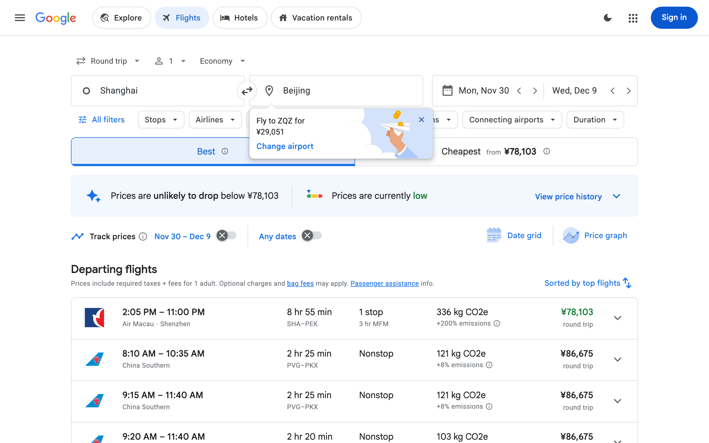
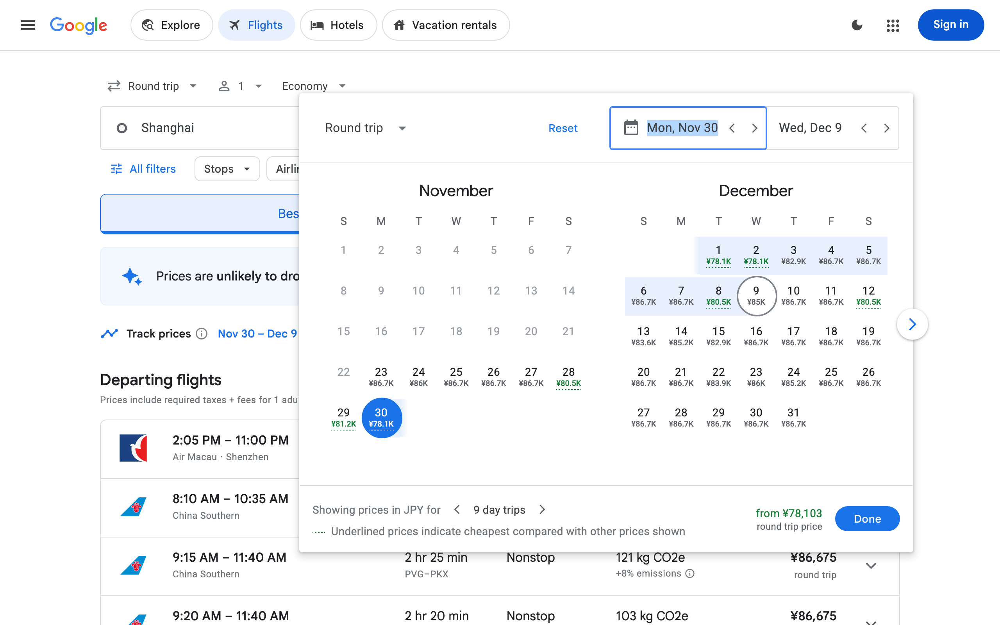
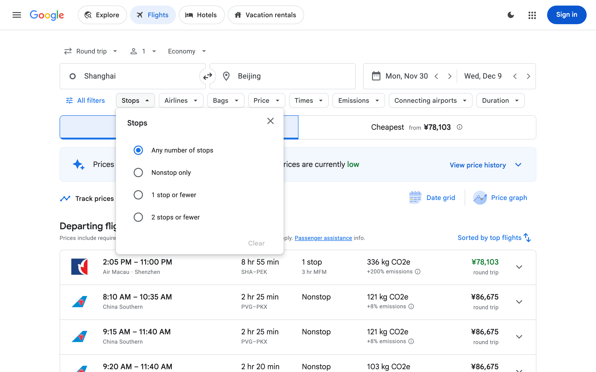
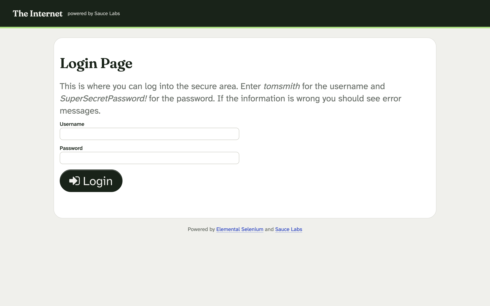
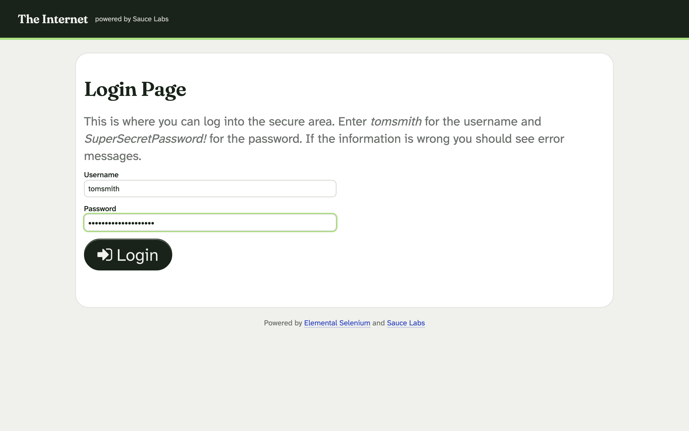
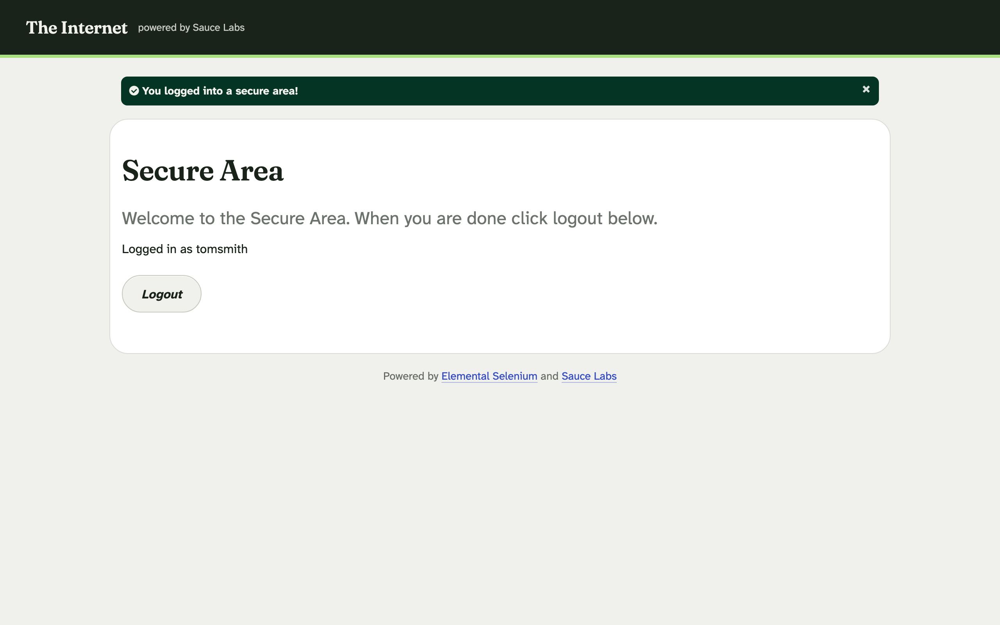
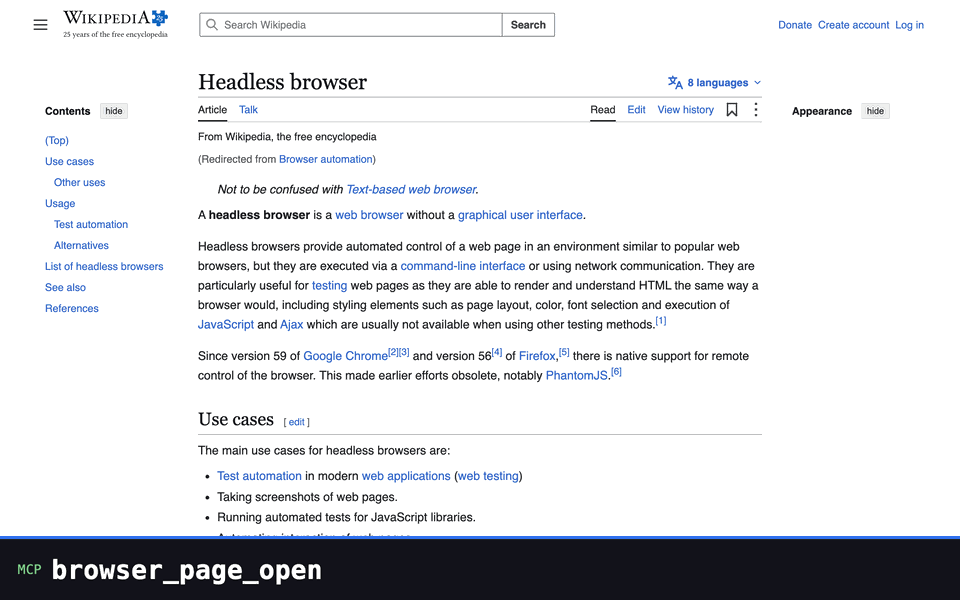

<h1 align="center">x-agint MCP</h1>

<p align="center">
  Three Model Context Protocol servers that give an AI agent a working computer:<br/>
  a shell, a filesystem, and a browser.
</p>

<p align="center">
  <a href="#bashsystem">bashsystem</a> ·
  <a href="#filesystem">filesystem</a> ·
  <a href="#browser">browser</a> ·
  <a href="#install">install</a> ·
  <a href="#benchmarks">benchmarks</a>
</p>

---

Every screenshot and video in this repository was captured from a **real website** by these servers
— no mockups, no fixtures. The flight prices are quotes Google actually returned; the song is
actually playing.

| | |
|---|---|
| [`bashsystem`](#bashsystem) | run shell commands, with a permission model that survives `rm` |
| [`filesystem`](#filesystem) | read / write / search files inside an allowlist |
| [`browser`](#browser) | drive Chromium: read pages as structured text, click, fill, debug |

All three are **stdio or HTTP MCP servers**, so they work with any MCP client (Claude Desktop,
Cursor, Cline, or your own agent host).

---

## What an agent actually does with them

### Read a page, then act on what it read

Google Flights is not a static document — the agent has to drive it. It opens a query, reads the
result list as structured text (every flight arrives with a full `aria-label`: airline, times,
duration, layover, emissions, price), then operates the real filter widgets.

<table>
<tr>
<td width="33%"></td>
<td width="33%"></td>
<td width="33%"></td>
</tr>
<tr>
<td>74 results read as text, not pixels — <code>¥78,103</code> round trip, Air Macau via MFM, 3 hr layover</td>
<td><code>browser_page_click</code> on the departure field opens the date grid</td>
<td><code>browser_page_click</code> on the Stops control opens a real panel</td>
</tr>
</table>

The point is not that it can screenshot a page. It is that **the read and the act share one
coordinate system**: the `[N]` index the agent read at is the same index it clicks minutes later.

### Multi-step flows across pages

Searching a music site, following autocomplete, reaching the results table, starting playback:

<table>
<tr>
<td width="25%"></td>
<td width="25%"></td>
<td width="25%"></td>
<td width="25%"></td>
</tr>
<tr>
<td>library page read</td>
<td><code>browser_page_fill</code> → autocomplete offered <code>晴天-周杰伦</code></td>
<td><code>browser_page_click</code> → results table</td>
<td>playing: <code>晴天 (Live)</code>, 00:02 / 04:09</td>
</tr>
</table>

Watch it end to end: **[migu-play.webm](assets/demos/migu-play.webm)** ·
**[flights-search.webm](assets/demos/flights-search.webm)**

### Form filling, and knowing it worked

The agent does not guess whether a submit succeeded — every action tool returns the page *after*
the change, so success is read from the same call that caused it.

<table>
<tr>
<td width="33%"></td>
<td width="33%"></td>
<td width="33%"></td>
</tr>
<tr>
<td>form read</td>
<td><code>browser_page_fill</code> ×2</td>
<td><code>browser_page_click</code> → the page confirms it</td>
</tr>
</table>

### Read → search → follow, without re-reading the whole page



Five steps of a real session. Each frame is one tool call; the caption names only the tool, so you
can see *which* capability did what.

---

## bashsystem

Run shell commands on the host. The interesting part is what it refuses.

```jsonc
// MCP config
{ "command": "x-bashsystem" }
```

**A deny-list of dangerous paths always misses one.** So `rm` is not matched by pattern — it is
checked against an *allowlist of directories*: a delete is allowed when its target resolves inside
one, refused otherwise. That holds for forms a regex cannot express:

```bash
{ rm -rf /etc; }        # refused — command boundary detected
( rm -rf /usr )         # refused
if true; then rm -rf /  # refused
env X=1 rm -rf /var     # refused — exec wrappers unwrapped to the real command
```

Other structural guards: `mkfs`, raw-device writes (`dd of=/dev/disk…`), `find -exec` (judged by its
reconstructed payload; `-execdir` with a deleting payload is refused outright because per-match
directory execution cannot be confined), `su`/`doas`, and `chmod` — where only the *recursive* form
is policed, on purpose.

Two layers, deliberately separate:

| Layer | Where it lives | Removable? |
|---|---|---|
| Hard blocks | compiled into the server | **no** |
| Configurable blocks | `blockedCommands` in `config.json` | yes |
| sudo | `sudoCommands` — an **allowlist**: a match means permitted | per-user policy |

Long-running work does not block the call:

```jsonc
{ "command": "npm run dev", "background": true }
// -> { status: "backgroundStarted", pid, pgid, logPath }
```

Foreground commands are detached into their own process group, so cleanup reaches grandchildren
(`SIGKILL` to `-pgid`) rather than leaving orphans — the failure mode that plagues naive MCP shell
tools.

---

## filesystem

Read, write, search and manage files inside an allowlist.

```jsonc
{ "command": "x-filesystem" }
```

**Reading is windowed by design.** A 12,000-line log does not have to be slurped:

```jsonc
{ "path": "app.log", "offset": -50 }                 // last 50 lines (negative counts from the end)
{ "path": "app.log", "offset": 900, "count": 200 }
{ "path": "small.md", "tryFullRead": true }           // as much as fits, capped at 500
```

Results report `from` / `to` / `total`, so the agent knows whether to page further.

**Editing is targeted, not whole-file.** `edit_file` applies exact-text replacements, with `dryRun`
to preview and `needDiff` for a unified diff. Writes are atomic (`wx` + temp file + rename).

**Searching beats walking.** `search_text` shells out to ripgrep via `execFile(rgPath, argv[])` —
never a built shell string from user input.

Every handler starts with `validatePath()`: the allowlist is enforced lexically, follows symlinks via
`realpath`, and validates the nearest existing ancestor for new files. A path outside is refused
before any filesystem call happens.

---

## browser

Drive Chromium through Playwright. The design bet: **text beats screenshots** for an agent.

```jsonc
{ "command": "x-browser" }
```

A page read returns a tree of nodes, each with a stable `[N]` index and markers describing what the
node *is*:

```
[VIEWPORT]{SCROLLABLE width=1198 height=968 scrollWidth=1198 scrollHeight=6387 scrollTop=0}
[291]<input aria-label="Where from?" value="Shanghai">
[654]<div aria-label="From 78103 Japanese yen round trip total. 1 stop flight with Air Macau.
       Leaves Shanghai Hongqiao at 2:05 PM … Layover (1 of 1) is a 3 hr layover at Macau
       International Airport … Select flight" role="link">
[323]{INNERTEXT_MOREABLE from=1 to=20 total=508}<div> Round trip … November …
```

That encoding is what makes everything else cheap:

- **`{SCROLLABLE}`** carries `scrollWidth/Height` and the current offset — the agent knows content
  exists below *without* scrolling to discover it.
- **`{INNERTEXT_MOREABLE total=508}`** says 508 lines exist, 20 shown — read more only if needed.
- **The `[N]` is stable for the node's lifetime**, so `search → click → re-read` address the same
  element. No re-locating by CSS, no brittle selectors.

Cost-ordered reading (each step heavier than the last):

| | tool | when |
|---|---|---|
| 1 | the return value of the action you just took | always first — actions return the changed page |
| 2 | `browser_element_search` / `browser_page_search` | you have a keyword |
| 3 | `browser_get_element_content` / `browser_read_element_*` | you know `[N]` |
| 4 | `browser_get_viewport_content` | fallback, whole page unknown |
| 5 | `browser_page_evaluate` | last resort — runs JS, re-reads the page before and after |

### Debugging what the page cannot show you

The capture channel writes to disk, so it is auditable after the fact:

```jsonc
{ "id": "…", "options": { "network": true } }
// -> filePath: …/page-<id>/network-<…>.jsonl — one JSON object per line, safe to tail live
```

Real example from this repo's material — proving a streaming player actually fetched audio when the
DOM showed nothing:

```text
app.c.nf.migu.cn/strategy/pc/can-listen/v1.0            ← permission check
app.c.nf.migu.cn/…/listen/v2.0?…copyrightId=60054704101
→ d.musicapp.migu.cn/data/oss/resource/00/3u/hb/fe30fb977b88415b921b3cb31f953a25   ← the audio
```

The page had **no `<audio>` element and no player global on `window`**, so `querySelector('audio')`
returned null and there was nothing to read visually. The answer came from the network capture plus
`performance.getEntriesByType('resource')` (152 entries). Full write-up:
**[docs/debugging.md](docs/debugging.md)**.

Console capture works the same way, including `pageerror` for uncaught exceptions — which is how you
find a failure that never rendered anything.

---

## Install

```bash
npm install @x-agint/bashsystem @x-agint/filesystem @x-agint/browser
```

Each ships a CLI. `--help` is written **for an agent to read**, and always carries the minimal MCP
host config (both the stdio spawn form and the HTTP connect form):

```bash
x-bashsystem --help
x-filesystem --help
x-browser --help
```

`browser` downloads Chromium in `postinstall`; if that download fails it does not break install —
the failure surfaces at runtime with instructions.

### HTTP instead of stdio

For a machine you reach over a network rather than a process you spawn:

```jsonc
{
  "mcpServers": {
    "remote-box": {
      "url": "https://<host>/fs/mcp",
      "headers": { "X-MCP-Endpoint": "<mcpAuthToken>" }
    }
  }
}
```

Note the header name: **`X-MCP-Endpoint`**, not `Authorization: Bearer`. A token never changes what
is bound — set `mcpHost` explicitly, keep the primary instance on `127.0.0.1`, and put a
TLS-terminating proxy in front (this repo's own setup uses `tailscale serve`, tailnet-only).

The allowlist is enforced **on the machine the server runs on**. Nothing a client sends widens it.

---

## Benchmarks

Measured on this host, not marketing numbers. Method and per-task breakdown:
**[docs/benchmarks.md](docs/benchmarks.md)**.

| | |
|---|---|
| Model | `deepseek-v4-flash` |
| Tasks completed | **5 / 5** |
| Total wall time | **122.2 s** |
| Tokens consumed | 774,650 (cache-miss: 53,449) |
| Tool calls | 40 |

The token figure is the honest one to read: MCP tools are text-heavy, and a page read costs real
tokens. That is *why* the read tools are windowed and cost-ordered rather than dumping pages.

---

## Design notes worth stealing

1. **Return the world after the action.** Every mutating tool returns the changed state. The agent
   needs no separate verification call, and cannot silently believe an action worked.
2. **Make volume explicit.** `{INNERTEXT_MOREABLE total=508}`, `from`/`to`/`total` in file reads — a
   truncated payload says so, instead of looking complete.
3. **Stable identity beats re-locating.** A node's `[N]` survives across calls; CSS selectors and
   pixel coordinates do not.
4. **Guard structure, not strings.** A deny-list regex for `rm` leaked 12 of 16 shell forms when
   tested. Parsing tokens and checking an allowlist is what actually holds.
5. **Errors are addressed to the model.** "Try `browser_page_list` to see open pages" beats "page not
   found", because the next action is the point.
6. **Keep the daemon and the browser separate.** Ending a session must not kill a browser that still
   owns pages — and stopping the daemon deliberately does *not* stop the server, which is why every
   cleanup script must stop both or Chromium is orphaned at PID 1.

---

## License

MIT — see [LICENSE](LICENSE).

The npm packages are published; **their source is not**. This repository is documentation and
reproducible capture scripts only. The scripts under [`scripts/`](scripts/) drive the published
servers over MCP, so every asset here can be regenerated without the implementation.
