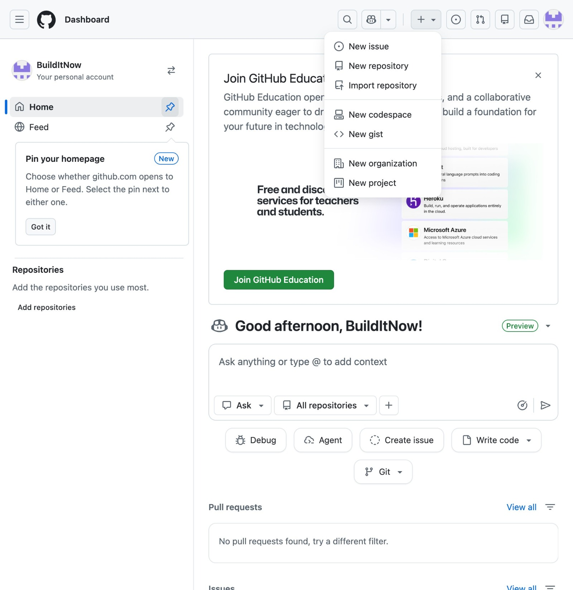
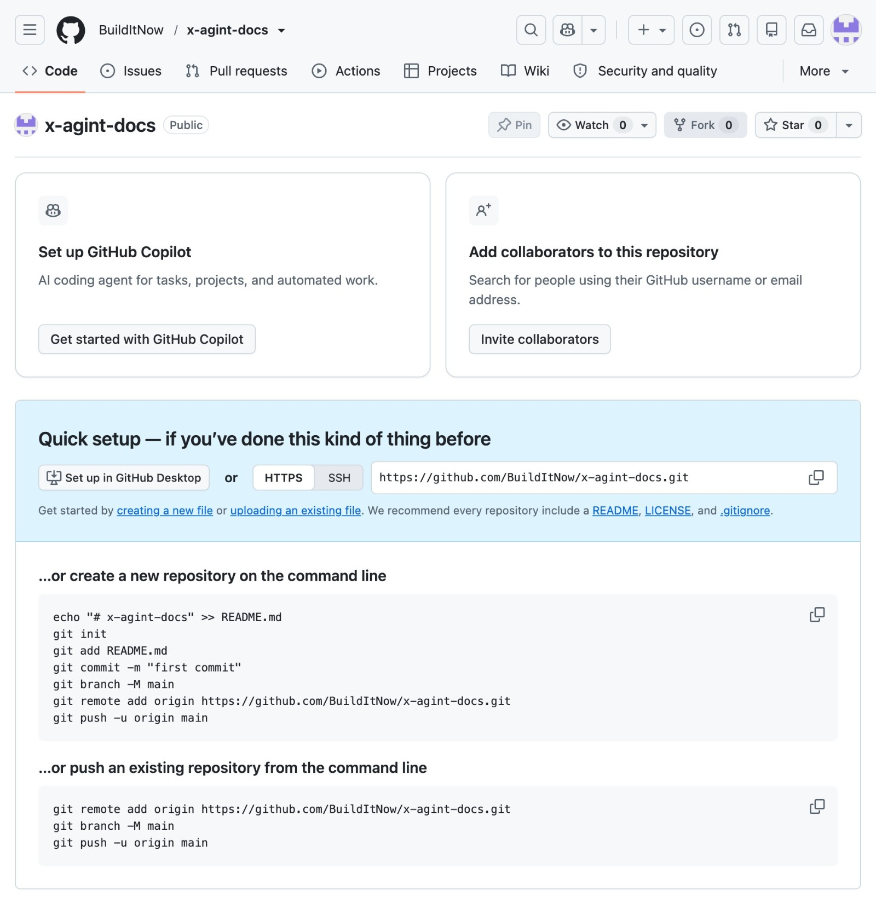
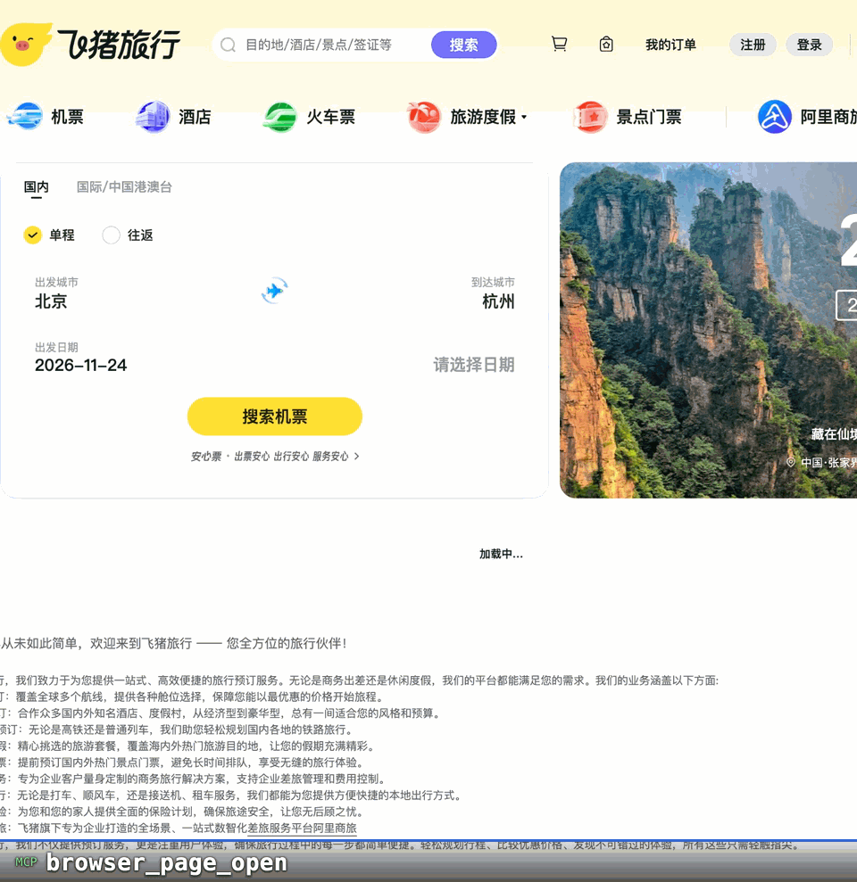
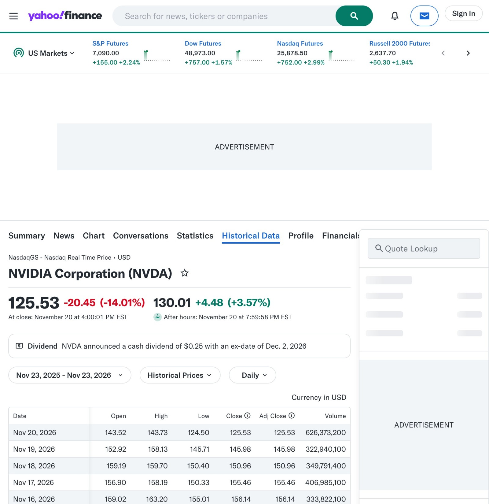

<h1 align="center">x-agint MCP</h1>

<p align="center">
  Three Model Context Protocol servers that give an AI agent a working computer:<br/>
  a shell, a filesystem, and a browser.
</p>

<p align="center">
  <a href="#bashsystem">bashsystem</a> ·
  <a href="#filesystem">filesystem</a> ·
  <a href="#browser">browser</a> ·
  <a href="#install">install</a> ·
  <a href="#benchmarks">benchmarks</a> ·
  <a href="#tools">all tools</a>
</p>

---

Every screenshot and video in this repository was captured from a **real website** by these servers
— no mockups, no fixtures. The flight prices are quotes the site actually returned; the song is
actually playing.

Each server's full tool reference lives in `docs/`, one directory per server:
**[bashsystem](docs/bashsystem/bashsystem.md)** · **[filesystem](docs/filesystem/filesystem.md)** ·
**[browser](docs/browser/browser.md)**. The combined index is the [Tools](#tools) section below.

| | |
|---|---|
| [`bashsystem`](#bashsystem) | run shell commands, with a permission model that survives `rm` |
| [`filesystem`](#filesystem) | read / write / search files inside an allowlist |
| [`browser`](#browser) | drive Chromium: read pages as structured text, click, fill, debug |

All three are **stdio or HTTP MCP servers**, so they work with any MCP client (Claude Desktop,
Cursor, Cline, or your own agent host).

---

## What an agent actually does with them

These are **browser-server demos** — every capture in this repository is driven by `@x-agint/browser` (see the
[browser](#browser) section). None of these targets is a static document — the agent has to drive it. Each demo
below was captured live through the MCP tools; each frame **is** one tool call's screenshot, saved by that
same call and then moved into the demo directory, so the image and the tool log come from the same action.

### Publish a repository to GitHub — driving a real product UI

The first demo drives a logged-in product rather than a public page: create an empty repo and push
the existing local history. Same capture method — each frame is one tool call's own screenshot,
named in call order. The agent stops short of anything irreversible beyond the repo itself; it never touches
billing or deletes anything.


<table>
<tr>
<td width="33%"></td>
<td width="33%"></td>
<td width="34%"></td>
</tr>
<tr>
<td><code>browser_page_open</code> → <code>github.com/</code>; signed in as <code>BuildItNow</code></td>
<td><code>browser_page_click</code> [55] the create “+” menu → <code>New repository</code> item appears</td>
<td><code>browser_page_fill</code> [130] "x-agint-docs" → return reports <code>x-agint-docs is available.</code></td>
</tr>
<tr>
<td width="33%"></td>
<td width="33%"></td>
<td width="34%"></td>
</tr>
<tr>
<td><code>browser_page_click</code> [468] New repository → navigate to <code>/new</code></td>
<td><code>browser_page_open</code> the repo URL → Quick setup shows <code>…/x-agint-docs.git</code></td>
<td><code>git push -u origin main</code> then <code>browser_page_reload</code> → tree at <code>f4a843f</code></td>
</tr>
</table>

The interesting part is the **fill return**, not the screenshot: typing the name makes GitHub answer
`x-agint-docs is available.` in the same change set (`NODE_ADDED`), so availability is confirmed from the tool
result rather than by eye. The create click then leaves the page momentarily unresponsive (the form POST runs a
long script); `browser_page_close` reports the tab had already navigated to
`github.com/BuildItNow/x-agint-docs` — that URL, not a claim, is the proof the repo exists. The push itself is a
plain `git remote add origin … && git push -u origin main`; GitHub's own Quick-setup panel prints those exact
commands on the empty-repo page (frame 5).

### Book a flight — read, then act on what it read



<table>
<tr>
<td width="25%"></td>
<td width="25%"></td>
<td width="25%"></td>
<td width="25%"></td>
</tr>
<tr>
<td><code>browser_page_open</code> — form prefilled 北京 → 杭州, 2026-11-24</td>
<td><code>browser_page_click</code> on <code>搜索机票</code> → a new tab with the flight list</td>
<td><code>browser_page_search</code> / <code>click</code> → 起飞时段 dropdown</td>
<td><code>browser_page_click</code> on 上午 (00:00-11:59) → list narrows to 07:25–11:30 departures</td>
</tr>
<tr>
<td width="25%"></td>
<td width="25%"></td>
<td width="25%"></td>
<td width="25%"></td>
</tr>
<tr>
<td><code>browser_page_click</code> — swap 上午 off, 下午 (12:00-17:59) on</td>
<td><code>browser_page_click</code> on the price column → ascending; first row ¥260</td>
<td><code>browser_read_element_children</code> → the exact <code>&lt;button aria-label="预订"></code></td>
<td><code>click</code> that button → order page, behind login</td>
</tr>
</table>

The submit button is found by its **visible label**, not a selector: `browser_page_search("搜索机票")`
returns one hit at `[149]`, and clicking `[149]` opens the results tab. The same index space runs
through the whole flow — checking 上午 removes 47 rows and re-renders only morning departures, which
the click return reports as `NODE_REMOVED` / `NODE_ADDED` rather than leaving the agent to guess.

Then it *chooses*, from what it read. Swapping the filter to 下午 leaves six afternoon flights; sorting
by price (`click [225]` — the column title flips to 「点击按票价从高到低」, which is how the ascending
state is confirmed) puts the cheapest first, and reading the rows one at a time gives the comparison:

| Afternoon flight | Price | Seats |
|---|---|---|
| **厦航 MF8150** 13:10→15:20 大兴/萧山T3 | **¥260 (1.2折)** | 3张 |
| 东航 MU5147 12:20 | ¥300 | 少量 |
| 南航 CZ8627 12:25 | ¥300 | 少量 |
| 东航 MU5191 14:00 | ¥300 | 少量 |
| 东航 MU5133 15:35 | ¥350 | 少量 |
| 河北 NS8033 17:15 | ¥400 | 少量 |

MF8150 is the cheapest **and** a full-service carrier — the expanded fare panel says 航司直营 ·
托运行李20公斤, so it is not a baggage-excluded budget fare. `browser_read_element_children [5340]`
then names the exact control (`[5369]<button aria-label="预订">`), and clicking it navigates to
`fbuy.fliggy.com/travel/confirm_order.htm?…bizType=flight…quantity:1` — wrapped in a login redirect,
because no credentials are held here. **The agent gets the booking flow started; it does not log in as
you or pay.**

The point is not that it can screenshot a page. It is that **the read and the act share one
coordinate system**: the `[N]` index the agent read at is the same index it clicks minutes later.

### Play a recommended playlist — picking, not just pressing

Same capture method on a music site: open the library, *choose* from what the page recommends, then
play it. Each frame is one tool call's own screenshot.


<table>
<tr>
<td width="25%"></td>
<td width="25%"></td>
<td width="25%"></td>
<td width="25%"></td>
</tr>
<tr>
<td><code>browser_page_open</code> — 乐库 home: a **推荐歌单** carousel with five playlists and play counts</td>
<td><code>browser_page_click</code> on the cover title → <code>#/playlist?playlistId=227616725</code>, **共161首**</td>
<td><code>browser_page_click</code> on <code>[912] 播放全部</code> → playing, <code>00:05 / 04:40</code></td>
<td><code>browser_page_click</code> on <code>[798] 下一首</code> → track 02, <code>00:16 / 04:35</code></td>
</tr>
</table>

The choice is made from the read. The home page lists five recommended playlists **with their play
counts** (`196.6万`, `305.0万`, `84.1万`, `198.6万`, …), so the agent picks the most-played one —
【华语怀旧向】80后的青春旧唱片 — rather than taking whatever is first.

And it never has to trust a click. The return value of each action *is* the evidence:

```text
click [912] 播放全部  ->  time: 00:01 / 04:40
                        <tr class="el-table__row playing-row">   ← row 01 marked
                        title="暂停"                             ← button flipped to pause
click [4783] (pause)  ->  playing-row removed, title="播放", time frozen at 00:15
click [4794] 下一首    ->  playing-row now on row 02
                        song-name: 单身情歌 / singers: 林志炫, 00:02 / 04:35
```

A pause is proven by the *absence* of the playing marker and a frozen timestamp — not by assuming the
button worked. That round trip (play → pause → resume → next) is what makes the demo verifiable rather
than decorative.

### Read the XHR behind a number — debugging a market page

The three demos above all *act* on a page. This one *reads what the page does not expose*: which interface call
feeds a number, and its exact return. The sequence is open → start capture → act → read the logs; each frame is
the page state at that step, and inspect writes **two separate logs** (network and console).

<table>
<tr>
<td width="33%"></td>
<td width="33%"></td>
<td width="34%"><code>network-excerpt.jsonl</code> + <code>console-excerpt.jsonl</code> — the two raw logs read back after the activity (see below)</td>
</tr>
<tr>
<td><code>browser_page_open</code> → <code>/quote/NVDA/history/</code>; header reads <code>NVDA 125.53 -20.45 (-14.01%)</code></td>
<td><code>browser_page_fill</code> [21] "AAPL" — fires a search XHR (typeahead); the page also re-pulls its quote</td>
<td><code>browser_page_inspect</code> read-back → two JSONL logs, scrubbed of the session <code>crumb</code></td>
</tr>
</table>

Sequence, in order — capture is **started before** the activity, and the page is **never closed during capture**
(closing deletes the whole capture directory):

```jsonc
// browser_page_open      -> https://finance.yahoo.com/quote/NVDA/history/   (frame 1)
// browser_page_inspect   -> { console: true, network: true,
//                             networkOptions: { categories: { fetchxhr: true } },
//                             maxFileBytes: 0 }            // 0 = unbounded, nothing rolls off
// browser_page_fill [21] "AAPL"  -> typeahead fires; page re-pulls its quote   (frame 2)
// browser_page_inspect   -> read the two logs back while the page is still open
```

The quote on screen is not in the page HTML — it arrives over an **XHR small enough to stay inline** in the
capture record, so the whole call (request *and* return) is one readable line. The two logs inspect writes:

```text
network-excerpt.jsonl  seq 12  xhr GET v7/finance/quote?&symbols=NVDA
                               bodySize 1235 · responseBody INLINE:
                               regularMarketPrice 125.53, change -20.45, changePercent -14.01,
                               postMarketPrice 130.01            ← matches the header verbatim
console-excerpt.jsonl  seq 32  error  a CSP img-src violation (full allowlist + location kept)
                       seq 33  info   "Powered by AMP ⚡ HTML – Version …" + script location
```

`seq 13` (the Trending-tickers call) sits one line away and is just over the inline threshold, so its body is
filed to disk instead — inline vs filed is itself the lesson. Inspect writes **one JSONL per channel**, so the
network log and console log are separate files; both carry a `time`, read together they reconstruct what the
page actually did.

Full write-up (the two raw logs, the inline-vs-externalized threshold, why this site was chosen):
**[docs/browser/inspect-demo.md](docs/browser/inspect-demo.md)**.

### Why every action returns the page it changed

The flight and playlist demos above are also the verification story: the agent never has to guess whether a click
worked, because each action tool returns the page *after* the change. That is why the playlist demo
can prove a pause (the `playing-row` class disappears and the timestamp freezes) rather than assume
one, and why the flight demo can confirm the sort direction from a column title instead of trusting
the click.

### Screenshots that land where you asked

The screenshot tools save to a file and return `{ filePath, fileSize }` — the same call both produces
the image and names where it went. That is how every frame in the demos above was made: no separate
screen recorder, so the image and the tool log cannot disagree.

The image lands in the page's own data directory,
`~/.x-agint/browser/pagedatas/page-<pageId>/screenshots/`, with a timestamp name — and the whole
directory is deleted when the page closes, so copy it elsewhere (a filesystem tool) if you need the
frame later. The demos above save each frame's committed path right after its capture call: the
committed frames must outlive the page.

The GIFs are assembled by [`scripts/make-gif.mjs`](scripts/make-gif.mjs) from a `steps.json` that names
the tool behind each frame, so both demos regenerate end to end:

```bash
node scripts/make-gif.mjs --steps assets/flight-demo/steps.json --out assets/flight-demo/flight-booking.gif
node scripts/make-gif.mjs --steps assets/migu-demo/steps.json  --out assets/migu-demo/migu-playlist.gif
```

The caption strip is rendered in a browser and composited with `overlay` — this ffmpeg build has no
`drawtext`/`ass`/`subtitles`, so text cannot be drawn by a filter. The strip is translucent (a solid
bar hid the page content underneath it) and names the tool only: arguments are long and belong in
prose.

---

## bashsystem

Run shell commands on the host. The interesting part is what it refuses.

```jsonc
// MCP config
{ "command": "x-bashsystem" }
```

**A deny-list of dangerous paths always misses one.** So `rm` is not matched by pattern — it is
checked against an *allowlist of directories*: a delete is allowed when its target resolves inside
one, refused otherwise. That holds for forms a regex cannot express:

```bash
{ rm -rf /etc; }        # refused — command boundary detected
( rm -rf /usr )         # refused
if true; then rm -rf /  # refused — control keyword starts a command
for f in x; do rm "$f"; done   # refused — the payload after `do` is judged
env X=1 rm -rf /var     # refused — exec wrappers unwrapped to the real command
```

Other structural guards: `mkfs`, raw-device writes (`dd of=/dev/disk…`), `find -exec` (judged by its
reconstructed payload; `-execdir` with a deleting payload is refused outright because per-match
directory execution cannot be confined), `su`/`doas`, and `chmod` — where only the *recursive* form
is policed, on purpose.

Two layers, deliberately separate:

| Layer | Where it lives | Removable? |
|---|---|---|
| Hard blocks | compiled into the server | **no** |
| Configurable blocks | `blockedCommands` in `config.json` | yes |
| sudo | `sudoCommands` — an **allowlist**: a match means permitted | per-user policy |

Long-running work does not block the call:

```jsonc
{ "command": "npm run dev", "background": true }
// -> { status: "backgroundStarted", pid, pgid, logPath }
```

Foreground commands are detached into their own process group, so cleanup reaches grandchildren
(`SIGKILL` to `-pgid`) rather than leaving orphans — the failure mode that plagues naive MCP shell
tools.

---

## filesystem

Read, write, search and manage files inside an allowlist.

```jsonc
{ "command": "x-filesystem" }
```

**Reading is windowed by design.** A 12,000-line log does not have to be slurped:

```jsonc
{ "path": "app.log", "offset": -50 }                 // last 50 lines (negative counts from the end)
{ "path": "app.log", "offset": 900, "count": 200 }
{ "path": "small.md", "tryFullRead": true }           // as much as fits, capped at 500
```

Results report `from` / `to` / `total`, so the agent knows whether to page further.

**Editing is targeted, not whole-file.** `edit_file` applies exact-text replacements, with `dryRun`
to preview and `needDiff` for a unified diff. Writes are atomic (`wx` + temp file + rename).

**Searching beats walking.** `search_text` shells out to ripgrep via `execFile(rgPath, argv[])` —
never a built shell string from user input.

Every handler starts with `validatePath()`: the allowlist is enforced lexically, follows symlinks via
`realpath`, and validates the nearest existing ancestor for new files. A path outside is refused
before any filesystem call happens.

---

## browser

Drive Chromium through Playwright. The design bet: **text beats screenshots** for an agent.

```jsonc
{ "command": "x-browser" }
```

### Demos — every capture in this repo is a browser-server demo

All four worked demos below belong to the browser server; each frame is one tool call's own screenshot, saved
by that same call and then moved into the demo directory, so the image and the tool log cannot disagree:

| Demo | What it shows | Frames + `steps.json` |
|---|---|---|
| **Publish to GitHub** | drive a logged-in product UI end-to-end: create repo, fill form, push (GitHub) | [`assets/github-demo/`](assets/github-demo/) |
| **Book a flight** | read → choose → act on one `[N]` index space (Fliggy) | [`assets/flight-demo/`](assets/flight-demo/) |
| **Play a playlist** | pick the most-played recommendation, prove playback by return values (Migu) | [`assets/migu-demo/`](assets/migu-demo/) |
| **Debug a market page** | read the inline XHR + console behind a number (`browser_page_inspect`, two logs) | [`assets/inspect-demo/`](assets/inspect-demo/) |

The first three are walked through in full **[What an agent actually does with them](#what-an-agent-actually-does-with-them)**
(leading with **publish to GitHub**); the inspect trace is also in **[Debugging what the page cannot show
you](#debugging-what-the-page-cannot-show-you)** and **[docs/browser/inspect-demo.md](docs/browser/inspect-demo.md)**.
The same galleries are mirrored on the reference page: **[docs/browser/browser.md](docs/browser/browser.md)**.

A page read returns a tree of nodes, each with a stable `[N]` index and markers describing what the
node *is*:

```
[VIEWPORT]{SCROLLABLE width=940 height=968 scrollWidth=1214 scrollHeight=2764 scrollTop=0}
[114]<input id="form_depCity" aria-label="出发城市，可直接输入城市名称搜索" value="北京">
[142]<input id="form_depDate" aria-label="出发日期，可直接输入如2026-04-09, 输入完成后，关闭日历"
       value="2026-11-24">
[149]<button class="search-button" aria-label="搜索北京到杭州的机票，跳转列表"> 搜索机票
```

Captured from the flight demo above. The button's whole action is in its `aria-label`, so searching
the visible text `搜索机票` returns exactly one hit — and `[149]` is what gets clicked.

That encoding is what makes everything else cheap:

- **`{SCROLLABLE}`** carries `scrollWidth/Height` and the current offset — the agent knows content
  exists below *without* scrolling to discover it.
- **`{INNERTEXT_MOREABLE total=508}`** says 508 lines exist, 20 shown — read more only if needed.
- **The `[N]` is stable for the node's lifetime**, so `search → click → re-read` address the same
  element. No re-locating by CSS, no brittle selectors.

Cost-ordered reading (each step heavier than the last):

| | tool | when |
|---|---|---|
| 1 | the return value of the action you just took | always first — actions return the changed page |
| 2 | `browser_element_search` / `browser_page_search` | you have a keyword |
| 3 | `browser_get_element_content` / `browser_read_element_*` | you know `[N]` |
| 4 | `browser_get_viewport_content` | fallback, whole page unknown |
| 5 | `browser_page_evaluate` | last resort — runs JS, re-reads the page before and after |

### Debugging what the page cannot show you

The capture channel writes to disk, so it is auditable after the fact:

```jsonc
{ "id": "…", "options": { "network": true } }
// -> filePath: …/pagedatas/page-<id>/inspects/network.jsonl — one JSON object per line, safe to tail live
```

Real example from this repo's material — proving a streaming player actually fetched audio when the
DOM showed nothing:

```text
app.c.nf.migu.cn/strategy/pc/can-listen/v1.0            ← permission check
app.c.nf.migu.cn/…/listen/v2.0?…copyrightId=60054704101
→ d.musicapp.migu.cn/data/oss/resource/00/3u/hb/fe30fb977b88415b921b3cb31f953a25   ← the audio
```

The page had **no `<audio>` element and no player global on `window`**, so `querySelector('audio')`
returned null and there was nothing to read visually. The answer came from the network capture plus
`performance.getEntriesByType('resource')` (152 entries). Full write-up:
**[docs/browser/debugging.md](docs/browser/debugging.md)**.

Console capture works the same way, including `pageerror` for uncaught exceptions — which is how you
find a failure that never rendered anything.

A full worked run — a foreign market-data page captured into inspect's **two separate logs**: a network log with
an inline `v7/finance/quote` **xhr**, and a console log with the page's own records:
**[docs/browser/inspect-demo.md](docs/browser/inspect-demo.md)**.

---

## Install

```bash
npm install @x-agint/bashsystem @x-agint/filesystem @x-agint/browser
```

Each ships a CLI. `--help` is written **for an agent to read**, and always carries the minimal MCP
host config (both the stdio spawn form and the HTTP connect form):

```bash
x-bashsystem --help
x-filesystem --help
x-browser --help
```

`browser` downloads Chromium in `postinstall`; if that download fails it does not break install —
the failure surfaces at runtime with instructions.

### HTTP instead of stdio

For a machine you reach over a network rather than a process you spawn:

```jsonc
{
  "mcpServers": {
    "bashsystem": { "url": "http://127.0.0.1:3060/mcp" },
    "filesystem": { "url": "http://127.0.0.1:3061/mcp" },
    "browser":    { "url": "http://127.0.0.1:3007/mcp" }
  }
}
```

Those are the three default HTTP endpoints (bashsystem 3060 / filesystem 3061 / browser daemon 3007).
Set `mcpHost` explicitly, keep the primary instance on `127.0.0.1`, and put a TLS-terminating proxy
in front when exposing it beyond loopback (this repo's own setup uses `tailscale serve`, which mounts
instances under a path like `/fs/mcp`).

The allowlist is enforced **on the machine the server runs on**. Nothing a client sends widens it.

### Sandboxed hosts (HOME virtualization)

Some MCP hosts run each server in a per-instance sandbox: they spawn the process through their own
Node launcher, **re-inject `HOME` to point at a runtime directory**, and derive the filesystem
allowlist from that virtual HOME (`$HOME/Downloads`, `$HOME/x-works`, …). That combination breaks all
three servers on such a host, in a specific way worth recognizing:

- The sandbox root usually contains only install artifacts (an npm cache) — the directories the
  allowlist names **were never created or mounted**, so every path is a phantom.
- The servers' own config (`~/.x-agint/**/config.json`) and the user-env file it reads resolve under
  the same virtual HOME, so they come up empty or absent.
- A request then fails with `Access denied - parent directory outside allowed directories` — the
  nearest *existing* ancestor (the sandbox root) is not in the allowlist, only its non-existent
  children are. This is by design: an allowlist authorizes a directory **tree**, and validating an
  unanchored phantom path would let any caller materialize directories anywhere.

Two fixes, in order of preference:

1. **Connect over HTTP instead of letting the host spawn the server.** A PM2-resident instance runs
   in the real environment with the real config; the host's HOME games cannot reach it (see "HTTP
   instead of stdio" above, and note that MCP roots offered at handshake replace the allowlist —
   configure them on the server side or not at all).
2. **Pin the config to a real absolute path** when you must use the spawn form:

```bash
npx @x-agint/filesystem --config-path /Users/<you>/.x-agint/filesystem/<host>-config.json
```

with `allowedDirectories` written as real paths. The allowlist merges with the user-env file when
that resolves, so real absolute entries are what make it work. Verify by reading the server's start
log: it prints the effective allowed directories — if they are all real paths on disk, the sandbox
no longer matters.

---

## Benchmarks

Measured on this host, not marketing numbers — one benchmark suite over these three servers, running
representative tasks against live websites.

| | |
|---|---|
| Model | `deepseek-v4-flash` |
| Tasks completed | **5 / 5** |
| Total wall time | **122.2 s** |
| Tokens consumed | 774,650 (cache-miss: 53,449) |
| Tool calls | 40 |

The token figure is the honest one to read: MCP tools are text-heavy, and a page read costs real
tokens. That is *why* the read tools are windowed and cost-ordered rather than dumping pages.

---

## Tools

Every tool listed in the per-server docs was read from a **running server** via MCP `tools/list` — not
copied from documentation. Signatures use `name(arg, opt?)`: required args first, optional marked `?`.

| Server | Tools | Doc |
|---|---|---|
| [`bashsystem`](docs/bashsystem/bashsystem.md) | **7** | permission model: hard blocks vs configurable blocks vs the sudo allowlist; why `rm` is an allowlist check and not a pattern |
| [`filesystem`](docs/filesystem/filesystem.md) | **16** | the path allowlist, and line-window reads where `offset: -50` means "last 50 lines" |
| [`browser`](docs/browser/browser.md) | **33** | the `[N]` index model, marker blocks, and the cost order for reading a page |

**56 tools total.**

### Verifying a catalog yourself

The three servers expose `tools/list` over Streamable HTTP, so the authoritative list is one request away:

```bash
x-browser --server status          # prints its url, e.g. http://127.0.0.1:3007/mcp

x-filesystem --config-path ~/.x-agint/filesystem/config.json --server start
x-bashsystem --server start
```

Any MCP client works. If you script it with the official SDK, note that the auth header must ride on
**every** request (POST, the SSE GET, and DELETE):

```js
const transport = new StreamableHTTPClientTransport(new URL(url), {
    requestInit: { headers: { 'X-MCP-Endpoint': token } },   // not `fetchImpl` — that key is ignored
});
```

Passing a made-up option name is silently accepted, the header never goes out, and the server answers 401
— which looks like a wrong token when the token was fine.

### Reading a real tool-call trace

Both demos above are driven through MCP, and each frame's tool is recorded in its `steps.json`
([`assets/flight-demo/steps.json`](assets/flight-demo/steps.json),
[`assets/migu-demo/steps.json`](assets/migu-demo/steps.json)). The playlist demo's call chain, with the
evidence each call returned:

```jsonc
// browser_page_open   -> 乐库 home; the read lists recommended playlists WITH play counts
//                        196.6万 / 305.0万 / 84.1万 / 198.6万 …
// browser_page_click [302]  -> URL becomes #/playlist?playlistId=227616725, list reports 共161首
// browser_page_search "播放全部" -> one hit: [912]<span class="active"> 播放全部
// browser_page_click [912]  -> time: 00:01 / 04:40
//                             <tr class="el-table__row playing-row">   ← row 01 marked
//                             title="暂停"                             ← button flipped to pause
// browser_page_click [798] 下一首 -> playing-row moves to row 02,
//                                    song-name: 单身情歌 / singers: 林志炫, 00:02 / 04:35
```

Note the shape: **locate by visible text → act on the returned `[N]` → read the change from the same
call's return**. The agent never re-reads the whole page — it narrows. And a pause is proven by the
*absence* of `playing-row` plus a frozen timestamp, not by assuming the button worked.

---

## Design notes worth stealing

1. **Return the world after the action.** Every mutating tool returns the changed state. The agent
   needs no separate verification call, and cannot silently believe an action worked.
2. **Make volume explicit.** `{INNERTEXT_MOREABLE total=508}`, `from`/`to`/`total` in file reads — a
   truncated payload says so, instead of looking complete.
3. **Stable identity beats re-locating.** A node's `[N]` survives across calls; CSS selectors and
   pixel coordinates do not.
4. **Guard structure, not strings.** A deny-list regex for `rm` leaked 12 of 16 shell forms when
   tested. Parsing tokens and checking an allowlist is what actually holds.
5. **Errors are addressed to the model.** "Try `browser_page_list` to see open pages" beats "page not
   found", because the next action is the point.
6. **Keep the daemon and the browser separate.** Ending a session must not kill a browser that still
   owns pages — and stopping the daemon deliberately does *not* stop the server, which is why every
   cleanup script must stop both or Chromium is orphaned at PID 1.

---

## License

MIT — see [LICENSE](LICENSE).

The npm packages are published; **their source is not**. This repository is documentation and
reproducible capture scripts only. The scripts under [`scripts/`](scripts/) drive the published
servers over MCP, so every asset here can be regenerated without the implementation.
