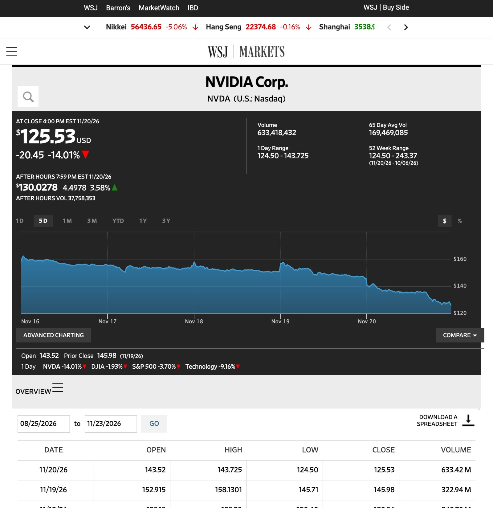

# Inspect demo: where a stock chart actually comes from

A live run against **WSJ Market Data** (a foreign market-data page), chosen because it is exactly the kind of
page an agent cannot read reliably: a big JS-rendered layout, hundreds of third-party ad requests, and a chart
whose numbers never appear as text in the HTML.

The question the demo answers: **what feeds the 5-day NVDA chart?** The rendered page cannot say. `browser_page_inspect` can.

Run through the published `@x-agint/browser` server on 2026-11-23. Raw evidence committed beside this page:
[`wsj-timeseries-request.json`](../../assets/inspect-demo/wsj-timeseries-request.json) — one network record, credentials redacted.

---

## The flow

<table>
<tr><td></td></tr>
<tr><td><code>browser_page_navigate_to</code> — <code>/market-data/quotes/NVDA/historical-prices</code>; the chart is in its default <b>5D</b> view</td></tr>
</table>

Sequence, in order:

```jsonc
// browser_page_open      -> https://www.wsj.com/market-data/quotes/NVDA
// browser_page_inspect   -> { console: true, network: true,
//                             networkOptions: { categories: { doc: true, fetchxhr: true } },
//                             maxFileBytes: 0 }            // 0 = unbounded, nothing rolls off
//   console.filePath : …/inspectdatas/page-<id>/console-<id>.jsonl
//   network.filePath : …/inspectdatas/page-<id>/network-<id>.jsonl
// browser_page_search "Historical" -> [156]<a role="tab" href="/market-data/quotes/NVDA/historical-prices">
// browser_page_navigate_to /market-data/quotes/NVDA/historical-prices  (capture survives the navigation)
```

**Capture is started before the navigation**, which is the whole trick: a channel opened after the click
misses the timeseries request the page fires on load.

---

## What the capture showed

212 network records for two navigations. Filtering to WSJ's own market API leaves **one**:

```text
seq  method  status  contentType                  bodySize   endpoint
140  GET     200     application/json; charset…   3505       api.wsj.net/api/michelangelo/timeseries/history
```

Record **140** is the chart's source:

```text
GET https://api.wsj.net/api/michelangelo/timeseries/history
      ?json={"Step":"PT5M","TimeFrame":"D5", … ,
             "Series":[{"Key":"STOCK/US/XNAS/NVDA","Kind":"Ticker","DataTypes":["Last"]}]}
status 200   contentType application/json; charset=utf-8   bodySize 3505

timings: durationMs 843.14 · ttfbMs 295.09 · dnsMs 0 (keep-alive) · connectMs 0 · downloadMs 843.07
```

`Step=PT5M` / `TimeFrame=D5` is a **5-minute step over a 5-day window** — which is exactly the chart view on
screen (`1D [5D] 1M …`, with **5D** highlighted). The request parameters and the rendered UI agree, and that
agreement is what identifies the endpoint as *this* chart rather than some other quote feed.

The payload decodes to two parallel arrays — `TimeInfo.Ticks` (epoch ms) and `Series[0].DataPoints`:

```text
TickCount 394 · Step 300000 (ms) · IsIntraday true
TimeZoneAbbreviation ET · UtcOffset -300 · Ticker NVDA · CommonName NVIDIA Corp.

2026-11-16 09:30 ET -> 158.76      first tick, market open
2026-11-16 09:35 ET -> 161.4101    second 5-min bar
…
2026-11-20 15:50 ET -> 127.24      second-to-last bar
2026-11-20 15:55 ET -> 125.81      last bar, market close

window min / max price: 125.81 / 162.445
```

That is the whole 5-day area chart: it opens near 158 on Nov 16, peaks at 162.445, and collapses to 125.81 at
the Nov 20 close — matching the visible curve (y-axis `$160 / $140 / $120`, x-axis `Nov 16 … Nov 20`) and the
summary row under it (`Open 143.52 · Prior Close 145.98 (11/19/26) · 1 Day NVDA -14.01%▼`).

The page's own table shows the same closes the series is built on:

| DATE | OPEN | HIGH | LOW | CLOSE | VOLUME |
|---|---|---|---|---|---|
| 11/20/26 | 143.52 | 143.725 | 124.50 | **125.53** | 633.42 M |
| 11/19/26 | 152.915 | 158.1301 | 145.71 | 145.98 | 322.94 M |

Note the last series point is **125.81** (the 15:55 bar, the last *trade* price) while the table close is
**125.53** (the official close). They differ by design — a chart built from 5-minute bars and an OHLC table are
different series. Reporting only one of them would hide that distinction.

---

## Why this site, and what "no externalized file" cost

The inspect tool files a response body to disk instead of inlining it once the payload is large. On Yahoo
Finance the history endpoint returned a 29 KB chart body, so the evidence had to be exported as a separate
JSONL. WSJ's timeseries body is small enough that the interesting part fits inline — so this demo commits
**one JSON record plus the decoded values in this page**, with no body file at all.

The tradeoff measured on the same run: WSJ still externalizes 49 bodies, but **every one of them is ad traffic**
(`securepubads.g.doubleclick.net/gampad/ads`, `rubiconproject`, `permutive`). The market-data path stays small.
That split — big ad payloads, tiny data payload — is itself visible only in the capture.

---

## The console half: noise is the signal to filter, not to read

The same page logs a wall of ad/CSP errors while its one data call succeeds. Reading console *alongside*
network is what lets you say "the data path is healthy; everything failing is third-party ad traffic" rather
than "this page is broken." The rendered page shows no trace of any of it.

Two records worth knowing how to read:

- **`status: 0` with `bodySize: -1`** means *no response was produced*, not a slow one — typical of ad calls the
  browser blocks before any network event (CSP, mixed content).
- **A missing record is not proof a request never ran.** Blocked-before-network requests leave no line at all,
  which is exactly why both channels were started together.

---

## Why this demo exists

The other two demos show an agent acting on a page. This one shows an agent **reading what the page does not
expose**: which endpoint feeds a chart, how long it took, and what it actually returned — without touching
DevTools, and with the whole transcript left as files on disk.

Capture files live under `~/.x-agint/browser/inspectdatas/page-<id>/` and are **deleted when the page is
closed** — read them first. Only a credential-redacted excerpt is committed here: the raw WSJ request carries
an `EntitlementToken` / `ckey`, and the capture also holds cookies and ad identifiers for a site this repository
does not own.
