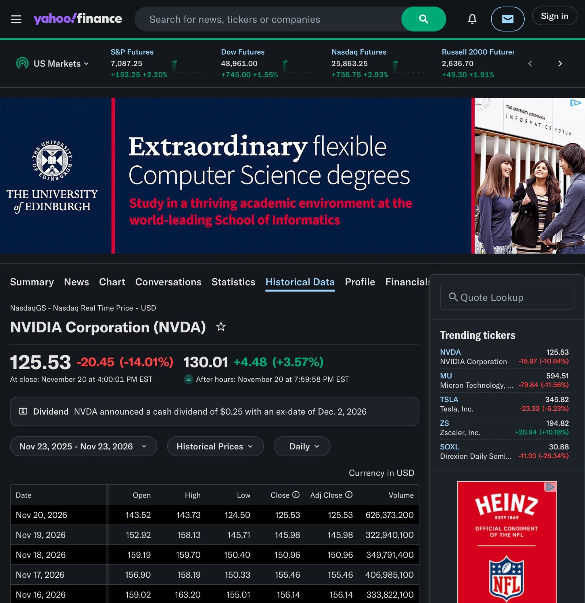

# Inspect demo: reading one small XHR off a live market page

A live run against **Yahoo Finance** (a foreign market-data page). The point of this demo is narrow and
practical: `browser_page_inspect` captures an **XHR whose response body is small enough to stay inline** in the
capture record — so the whole interface call, request *and* return, is one line you can read directly, with no
separate body file.

Run through the published `@x-agint/browser` server on 2026-11-23. The committed evidence is the **raw capture
log line itself**: [`yahoo-quote-xhr.log.jsonl`](../../assets/inspect-demo/yahoo-quote-xhr.log.jsonl) (one record,
`crumb` credential redacted).

---

## The flow

<table>
<tr><td></td></tr>
<tr><td><code>browser_page_navigate_to</code> — <code>/quote/NVDA/history/</code>; the top “US Markets” bar is what the XHR feeds</td></tr>
</table>

Sequence, in order:

```jsonc
// browser_page_open      -> https://finance.yahoo.com/quote/NVDA/history/
// browser_page_inspect   -> { network: true,
//                             networkOptions: { categories: { fetchxhr: true } },
//                             maxFileBytes: 0 }            // 0 = unbounded, nothing rolls off
//   network.filePath : …/inspectdatas/page-<id>/network-<id>.jsonl
// browser_page_fill [21] "NVDA"   -> typeahead fires; the page also re-pulls its market bar
```

**Capture is started before the activity.** The market-bar quote call fires on load and again when the page
refreshes; a channel opened afterwards would miss it.

---

## The one record that matters

75 fetch/XHR records came back for this page — most of them ad exchanges. Filtering to Yahoo's own market API
leaves a single small **xhr**:

```text
seq  method  status  resourceType  contentType                       bodySize   durationMs
 30  GET     200     xhr           application/json;charset=utf-8    923        168.67
```

```
GET https://query1.finance.yahoo.com/v7/finance/quote
      ?&symbols=ES=F,NQ=F,RTY=F,YM=F
      &fields=regularMarketPrice,regularMarketChange,regularMarketChangePercent,…
      &crumb=<REDACTED>&formatted=false&region=US&lang=en-US

status 200   contentType application/json;charset=utf-8   bodySize 923 (on the wire)
timings: durationMs 168.67 · ttfbMs 168.07 · dnsMs 0 (keep-alive) · connectMs 0 · downloadMs 168.55
responseBody -> INLINE, 3598 bytes, parsed straight from the record
```

Because the body is inline, the committed log line carries it verbatim — no `body-<seq>-res.json` to chase.
Parsed, it returns exactly four quotes:

| symbol | regularMarketPrice | change | change % |
|---|---|---|---|
| ES=F (S&P Futures)   | 7086.5   | +151.5  | +2.184571 |
| NQ=F (Nasdaq Futures)| 25860.75 | +734.25 | +2.9222136 |
| RTY=F (Russell 2000) | 2636.7   | +49.3   | +1.9053895 |
| YM=F (Dow Futures)   | 48958.0  | +742.0  | +1.5389082 |

Those are the four numbers in the page's top **US Markets** bar — visible verbatim in the screenshot:
`S&P Futures 7,087.25 +152.25 +2.20% · Dow Futures 48,961.00 … · Nasdaq Futures 25,863.25 … · Russell 2000
Futures 2,636.70 +49.30 +1.91%`. (The screenshot is taken after a reload, so the values have ticked up a hair
from the captured instant — e.g. ES=F 7086.5 → 7,087.25 — which is itself what a live market feed looks like.)

The match is the conclusion: that one XHR **is** the top bar. Nothing about it is in the page's HTML; you only
see it because the capture recorded the request and kept its body.

---

## Why this site, given the requirement “small XHR, inline”

The inspect tool files a response body to disk once the payload grows past an internal threshold; below it, the
body stays in the record. The earlier candidates failed that requirement:

| Site | Data call | Result |
|---|---|---|
| Yahoo history `chart` (1y daily) | ~29 KB | externalized to a body file ✗ |
| WSJ `michelangelo/timeseries` | 3.5 KB wire / ~11 KB JSON | externalized ✗ |
| Google Finance `batchexecute` | the NVDA chart call is ~9.7 KB | externalized; only an unrelated 792 B call stayed inline ✗ |
| **Yahoo `v7/finance/quote` (4 futures)** | **923 B wire / 3598 B JSON** | **inline ✓** |

So the demo targets the *quote* endpoint, not the *history* endpoint: same page, but the small four-symbol XHR
is the one that survives inline. That distinction — which of a page's many XHRs is small enough to read whole —
is exactly what reading the capture teaches.

---

## The console half: noise is the signal to filter, not to read

The same page fires dozens of ad-exchange calls (`casalemedia`, `rubiconproject`, `openx`, `pubmatic`, …) and a
stream of `browser-intake-datadoghq.com` RUM pings. None of them is the market data. Filtering 75 fetch/XHR
records down to one Yahoo quote call is the whole skill here — and it only works because capture records every
call with its `resourceType`, `contentType` and body, which the rendered page never shows.

---

## Why this demo exists

The other two demos show an agent acting on a page. This one shows an agent **reading what the page does not
expose**: which XHR feeds a number, how long it took, and its exact return — kept inline because the payload is
small, so the evidence is a single committed log line rather than a directory of body files.

Capture files live under `~/.x-agint/browser/inspectdatas/page-<id>/` and are **deleted when the page is
closed** — read them first. Only this one credential-redacted record is committed: the raw request carries a
session `crumb`, and the full capture also holds cookies and ad identifiers for a site this repository does not
own.
